# Workstation Student · 大学生工作台

**v1.1 · 个人工作台系列 · 第 3 期 · Developed by @赛博老爸**

[下载 ZIP](https://github.com/cyberdaddyleo/workstation-student/archive/refs/heads/main.zip) · [详细使用指南](docs/USER_GUIDE.md) · [许可协议](LICENSE) · [问题反馈](https://github.com/cyberdaddyleo/workstation-student/issues)

把课表、学科资料、成绩 GPA、证书驾照、考研 / 留学 / 求职规划，还有每天的睡眠、运动和吃饭，都放进一间宿舍里。

这是一个面向大学生的个人学习与生活管理工具。首页是一间可交互的宿舍：书架管理学科资料，平板查看成绩，台灯开启专注，床铺记录睡眠。主程序是单个 HTML 文件，无需部署服务器或安装依赖；下载后即可在电脑浏览器中使用，AI 服务为可选功能。

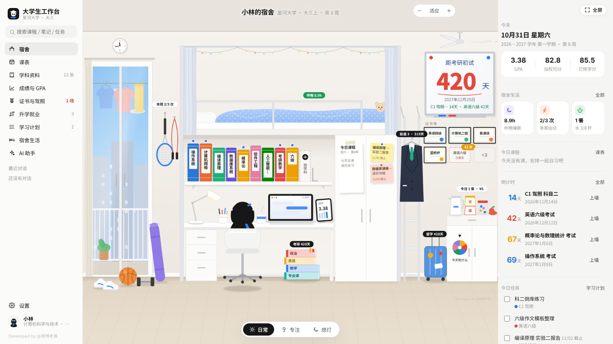

- **打开就能用**：只有一个 `index.html`，双击就能打开，不用安装，也不用注册
- **本地保存、离线可用**：日常功能的数据保存在本机浏览器里，无需账号；主动调用 AI 时才会向你配置的接口发送相应内容，详见[数据与备份](#数据与备份)
- **个人免费**：个人可以免费使用、修改和二次开发（商用需要授权，见文末）

> 第一次使用建议按这个顺序：**设置学期与作息 → 录入课表 → 整理学科资料 → 添加学习任务 → 导出第一份备份**。完整操作步骤见[详细使用指南](docs/USER_GUIDE.md)。

---

## 目录

- [快速开始](#快速开始)
- [功能一览](#功能一览)
  - [宿舍（首页）](#宿舍首页)
  - [课表](#课表)
  - [学科资料](#学科资料)
  - [成绩与 GPA](#成绩与-gpa)
  - [证书与驾照](#证书与驾照)
  - [升学就业](#升学就业)
  - [学习计划](#学习计划)
  - [宿舍生活](#宿舍生活)
  - [AI 助手](#ai-助手)
- [AI 接口设置（可选）](#ai-接口设置可选)
- [数据与备份](#数据与备份)
- [常见问题](#常见问题)
- [文件说明](#文件说明)
- [许可协议](#许可协议)

---

## 快速开始

1. 下载：点页面上方绿色的 **Code → Download ZIP**（如果有 Releases，也可以在 Releases 里下载），然后解压。
2. 双击 `index.html`，用 **Chrome** 或 **Edge** 打开。
3. 第一次打开会让你选一个形象，再选：
   - **先看看示例同学**：一个大三计算机专业的示例，课表、成绩、证书、规划、作息都有，适合先熟悉功能；
   - **直接用我自己的**：空宿舍，自己录入。
4. 看完示例，点左上角 **「开始用我自己的」** 就会清空示例数据，从头开始。

> **小提示**
> - 数据跟着浏览器走：请把 `index.html` 放在一个固定的位置，每次用同一个浏览器打开。
> - 在聊天软件、网盘或网页的「预览」里打开，可能无法持久保存数据。真正使用请下载后用浏览器打开，并在「设置 → 数据与备份」确认存储状态正常。
> - 本工具为电脑端设计，建议屏幕宽度 1280 以上。右上角可以一键全屏。

---

## 功能一览

### 宿舍（首页）

一间上床下桌的宿舍，屋里每样东西都能点：

| 宿舍里的东西 | 点开是什么 |
|---|---|
| 书架上的书 | **学科资料**，一本书就是一个学科（本学期的课自动上架，最后一格可以加自学科目） |
| 床 | **睡眠**：昨晚睡了多久，今晚建议几点睡 |
| 阳台边的球拍、跳绳、瑜伽垫、篮球 | **运动打卡** |
| 零食柜 | **三餐和伙食费**；柜门上的转盘是「今天吃什么」 |
| 桌上的马克杯 | 点一下就是**喝了一杯水** |
| 衣柜门上的纸和便利贴 | 今天（或明天）的**课表**、快到截止的**作业** |
| 墙上的白板 | **倒计时**：考研、考证、驾照约考、期末考试 |
| 证书墙 | **证书与驾照**，拿到的裱成奖状，在考的是虚线框 |
| 台灯 | 进入**专注模式** |
| 笔记本电脑 | **AI 助手** |
| 平板 | **成绩与 GPA** |
| 桌下的考研书、爬梯上的正装、行李箱、雪糕筒 | 你选的**升学就业方向**（考研、求职、留学、驾考……） |

书顶上的小圆点：**红色**是两周内要考试，**蓝色**是今天有复习卡片要背。鼠标放在东西上会弹出详情卡片，按住拖动可以移动视角，按住 Ctrl 滚动滚轮可以缩放。

底部有三个模式：

- **日常**：平时的样子
- **专注**：房间暗下来、台灯亮起，开始番茄钟，电脑屏幕上显示倒计时
- **熄灯**：拉上床帘睡觉，可以记录入睡时间；第二天点「我起床了」，自动算出睡了多久

<p>
  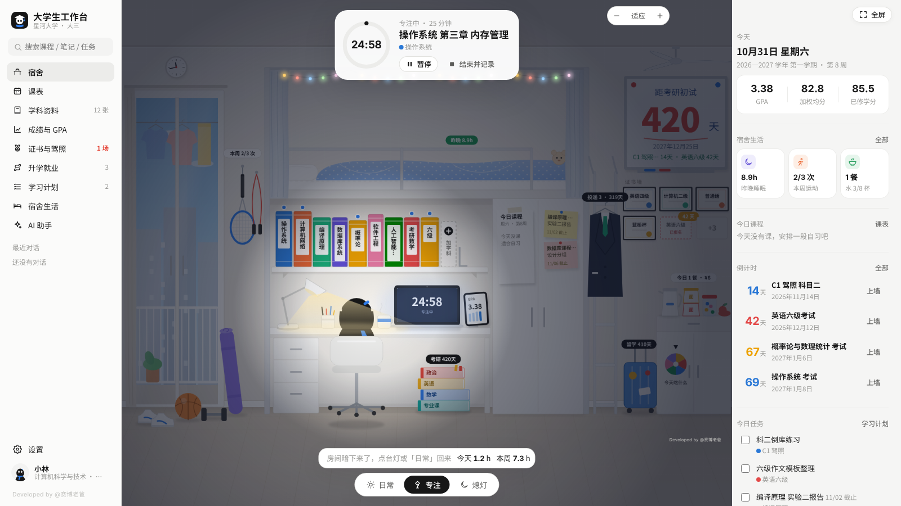
  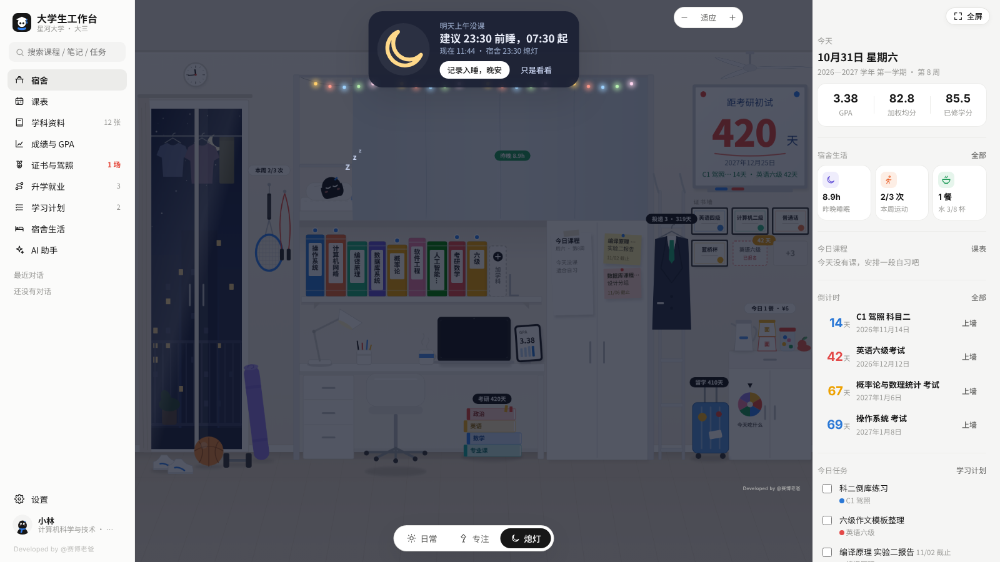
</p>

右侧栏是今天的概况：GPA、宿舍生活、今日课程、倒计时、今日任务和本周专注时长。

---

### 课表

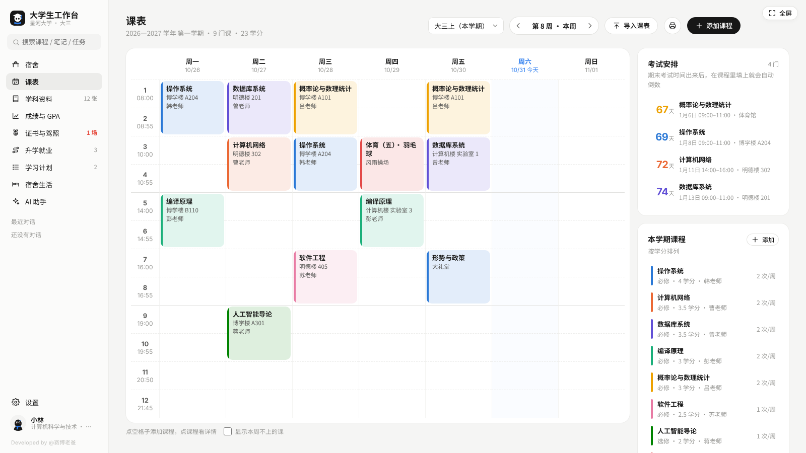

- 周视图，自动算出现在是第几周，标出今天和正在上的那节课
- **点空格子直接添加课程**，一门课可以有多个上课时间
- 支持**单双周**和指定周次（如 `1-8`、`4,8,12`）
- **导入课表**：从 Excel 复制带表头的课表粘贴进来，同名课程自动合并；教务系统只有截图的话，里面有一段现成的提示词，连同截图发给任意 AI，让它整理成表格再贴回来
- 右侧有**考试安排**倒计时，可以**打印课表**
- 每节课的上下课时间可以在「设置 → 学期与作息」里改

---

### 学科资料

<p>
  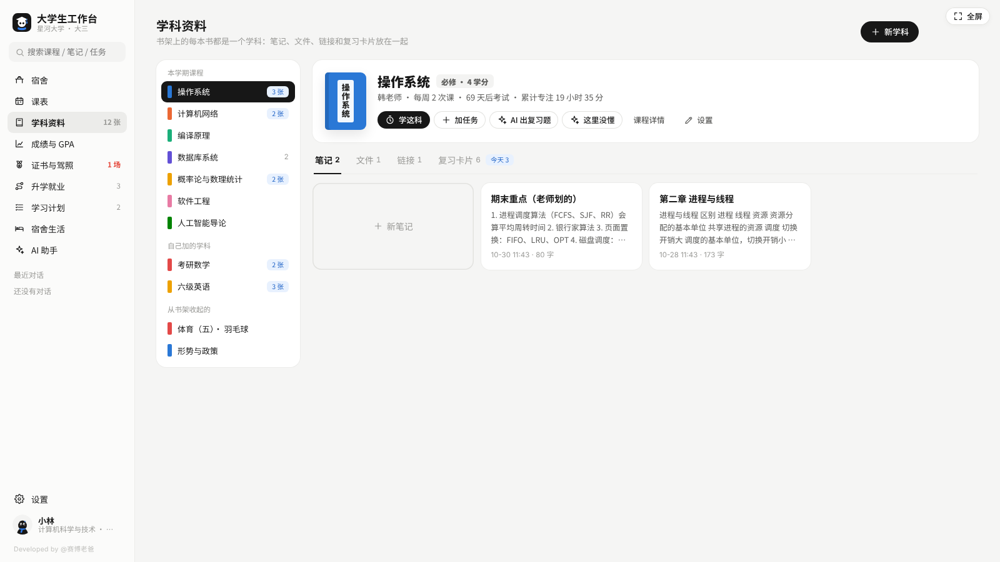
  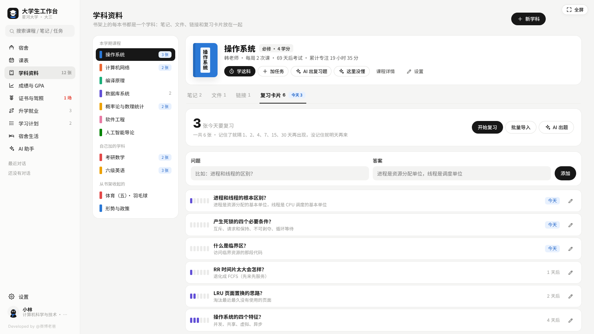
</p>

书架上的每本书都是一个学科，一门课的资料放在一起：

- **笔记**：支持 Markdown（标题、列表、表格、加粗），自动保存，可以导出 Word
- **文件**：课件 PDF、作业 Word、PPT、图片、往年题，直接拖进来就行（单个不超过 50 MiB，界面显示为 MB），图片、PDF 和文本可以直接预览
- **链接**：网课、题库、网盘、老师主页
- **复习卡片**：一问一答的知识点卡片，按间隔复习安排——记住了就隔 1、2、4、7、15、30 天再出现，没记住第二天再来；可以批量导入，也可以让 AI 根据笔记出题，一键存进来

其他：

- 本学期的课自动上架；考研数学、雅思、编程这类自学科目点「新学科」或书架上的「加学科」添加
- 不想放在书架上的课（比如体育）可以「收起」，资料还在
- 删除某门课程时，它的学科资料会保留下来，变成自学科目
- 每个学科可以直接「学这科」开始专注、添加任务

---

### 成绩与 GPA

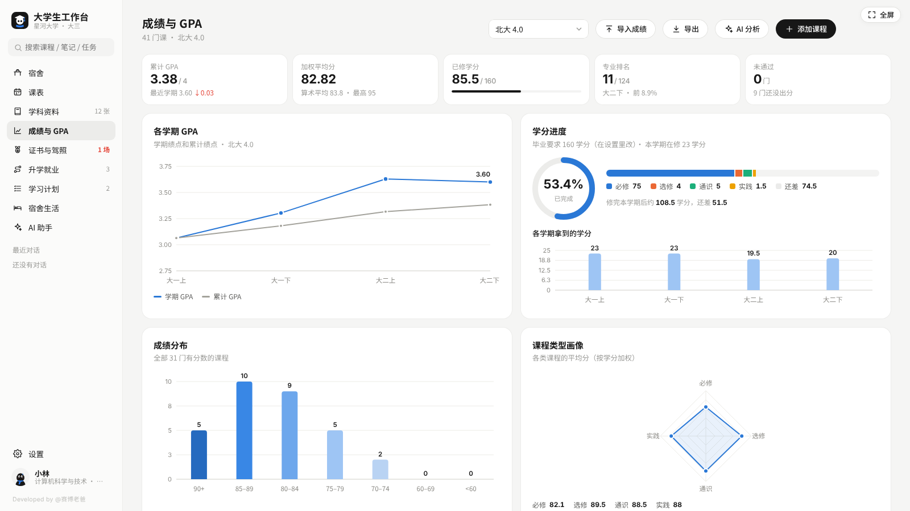

- 支持 4 种绩点算法：**北大 4.0、标准 4.0、改进 4.0（WES 常用）、5 分制**，可以随时切换对比
- 可以设置选修课、通识课是否计入 GPA
- 等级制成绩自动折算：优秀 95 / 良好 85 / 中等 75 / 及格 65；「通过 / 合格」只算学分不算绩点
- 图表：各学期 GPA 和累计 GPA 走势、学分进度（按必修 / 选修 / 通识 / 实践分开）、成绩分布、课程类型画像、单学期每门课成绩
- 每学期可以填**专业排名**
- **目标 GPA 计算器**：想把 GPA 提到多少，算出接下来每门课大概要考多少分
- 从教务系统复制成绩**批量导入**，**导出 CSV** 成绩单
- 挂科、补考和本学期考试集中提醒

---

### 证书与驾照

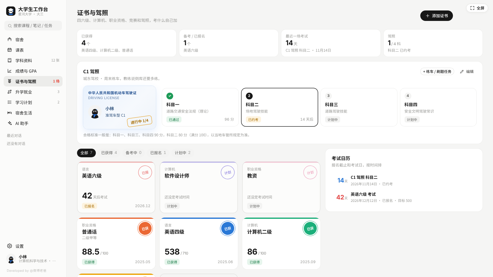

- 预设常见证书，选一个信息就帮你填好：四六级、雅思、托福、日语 N1 / N2、专四、计算机等级考试、软考、教师资格证、普通话、初级会计、CPA、法考、证券 / 基金 / 银行从业、数学建模、美赛、蓝桥杯、挑战杯、创新大赛等；没有的可以自定义
- 每个证书记录：状态（计划中 / 备考中 / 已报名 / 已获得 / 未通过）、考试日期、报名截止、成绩、满分、合格线、目标分
- **驾照**单独做了科目一到科目四的进度：每科状态、约考日期、成绩、考了几次
- **考试日历**：把报名截止和考试日按时间排好

---

### 升学就业

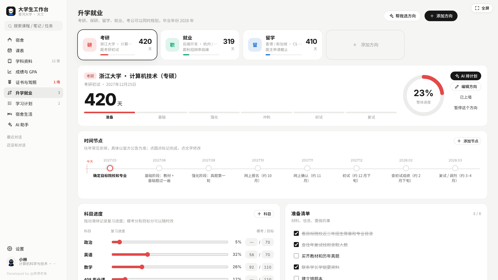

六个方向可以同时规划，互相做备选：**考研、保研、留学、就业、考公考编、自定义**。

- 选了方向，会按你的毕业年份、往年常见的时间节点生成计划（具体以官方公告为准，都可以改）
- **考研 / 考公**：备考阶段条（准备 → 基础 → 强化 → 冲刺 → 考试）、各科复习进度、模考分和目标分、目标院校笔记
- **保研**：自动读取 GPA、加权平均分、专业排名；夏令营 / 预推免进度看板
- **留学**：语言成绩和目标、选校清单（冲刺 / 主申 / 保底）、申请材料清单
- **就业**：求职漏斗、投递进度看板（想投 → 已投递 → 笔试测评 → 面试 → Offer），拖动卡片就能改状态
- 每个方向都有时间节点、准备清单、笔记和学习任务；关键日期可以「上墙」写到宿舍的白板上

---

### 学习计划

- **周计划看板**：周一到周日七列，直接输入就能加任务（结尾写「30分钟」会自动记成预计用时），拖动任务换到别的日子
- **收件箱**：还没排日期的任务先放这里
- 任务可以关联课程、学科、方向或证书；设了截止日期会在宿舍的便利贴和右侧栏提醒
- **专注计时**：25 / 45 / 60 / 90 分钟或自定义；切换页面不会中断，刷新页面也能接着计时，结束时有提示音
- 统计：本周专注时长、这周时间花在哪些课上、最近 20 周的专注热力图、连续专注天数

---

### 宿舍生活

<p>
  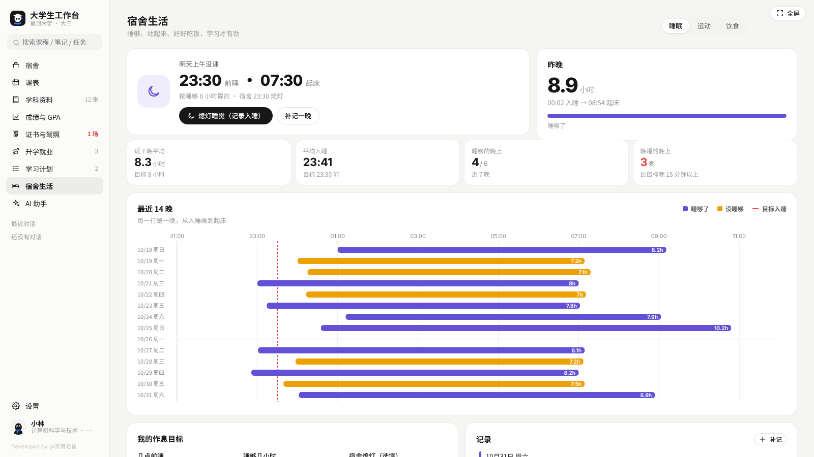
  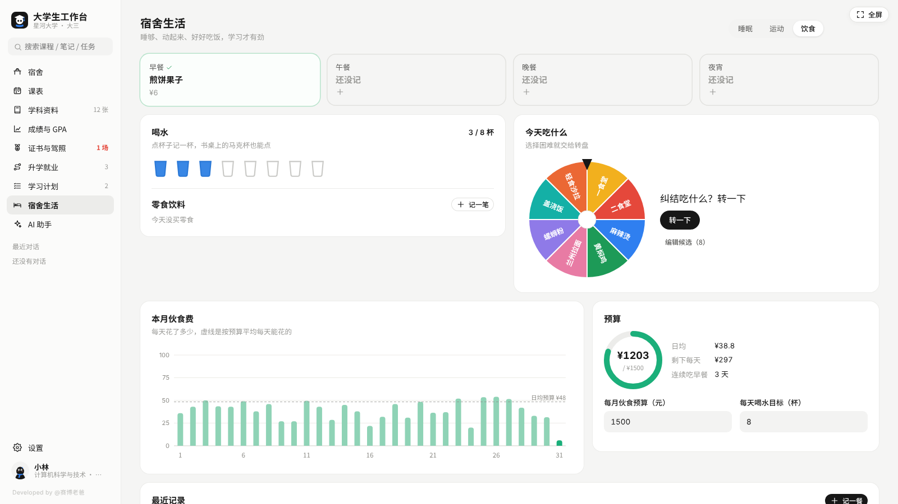
</p>

**睡眠**
- 熄灯 / 起床打卡，或者补记一晚
- 根据明天第一节课和你设的目标，算出今晚建议几点睡、几点起，有早八会特别提醒
- 最近 14 晚的睡眠图、平均睡眠时长、平均入睡时间、睡够了几晚、晚睡了几晚
- 可以设置目标入睡时间、目标睡眠时长、宿舍熄灯时间

**运动**
- 一键打卡：跑步、校园跑、篮球、羽毛球、健身、游泳、骑行、跳绳、瑜伽、散步
- 每周目标次数和分钟数，最近 12 周的运动时长，近 30 天在练什么
- 填上学校要求的**校园跑**次数，自动帮你数本学期跑了多少次
- **体测**：记录每一项的成绩和目标，看离目标还差多少（男生 / 女生项目可切换；评分标准以学校体测为准）

**饮食**
- 早餐、午餐、晚餐、夜宵打卡，顺手记一下花了多少钱
- 喝水杯数（宿舍桌上的马克杯也能点）
- 每月伙食预算：已经花了多少、日均多少、剩下每天还能花多少，连续吃早餐天数
- **「今天吃什么」转盘**：选择困难就转一下，候选可以改成你们学校的食堂窗口

---

### AI 助手

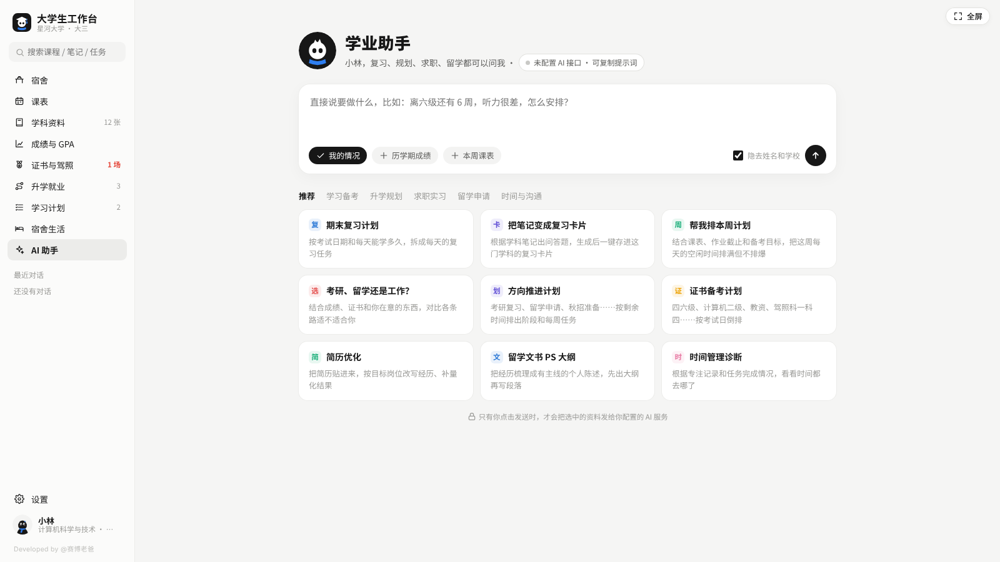

内置 18 个大学生常用场景，填几个空就能生成：

| 分类 | 模板 |
|---|---|
| 学习备考 | 期末复习计划、把笔记变成复习卡片、这个知识点没懂、证书备考计划、课程论文提纲、成绩分析 |
| 升学规划 | 考研 / 留学 / 工作怎么选、方向推进计划、考研择校思路 |
| 求职实习 | 简历优化、模拟面试、自我介绍 / 求职邮件、实习周记 / 报告 |
| 留学申请 | 留学文书 PS 大纲、推荐信草稿 |
| 时间与沟通 | 帮我排本周计划、时间管理诊断、给老师写邮件 |

- 会自动带上你的课程、成绩、证书、规划和作息，回答更贴合你自己
- 默认先把设置中至少两个字的**姓名和学校换成【我】【我的学校】**再发送，回答回来后自动换回；这不代表全面匿名化，专业、成绩、笔记等内容仍可能随模板发送
- 回答可以复制、导出 Word，存成学科笔记、方向笔记；AI 出的复习题可以一键存成复习卡片
- 也可以在输入框里直接提问，可选带上「我的情况」「历学期成绩」「本周课表」

---

## AI 接口设置（可选）

**不配置也能用 AI 助手**：点任意模板，会生成一段完整的提示词，复制到豆包、DeepSeek、Kimi、通义等任意 AI 的网页版或 App 里粘贴发送即可。

想在工作台里直接生成：

1. 打开「设置 → AI 接口」
2. 选服务商，按服务商控制台核对「接口地址（Base URL）」和「模型名称」，再填 API Key（到对应平台注册后创建；本地 Ollama 通常不需要 Key）
3. 点「测试连接」，显示连接成功后再使用模板或对话。预设模型名可能随服务商调整，请以自己的账号可用模型为准；豆包需要自行填写模型 ID 或推理接入点 ID

内置的服务商：DeepSeek、通义千问（阿里云百炼）、Kimi、智谱 GLM、豆包（火山方舟）、硅基流动、OpenAI、Claude、Ollama 本地模型，以及任何兼容 OpenAI 格式的接口（选「自定义」）。

**提示「连不上」怎么办**

有些服务商不允许网页直接调用（浏览器跨域限制）。可以先换一家试试，或者用包里的 `ai-proxy.js` 在本机中转：

1. 电脑安装 [Node.js](https://nodejs.org/)（18 或更新版本）
2. 在 `index.html` 所在的文件夹打开终端，运行：
   ```bash
   node ai-proxy.js
   ```
3. 在「设置 → AI 接口」里，把接口地址改成 `http://127.0.0.1:8787/` 加上原来的地址，例如：
   ```
   http://127.0.0.1:8787/https://api.deepseek.com
   ```

使用时保持终端运行，结束后按 `Ctrl + C` 停止。中转程序只监听本机 `127.0.0.1:8787`，不持久保存请求内容，只支持 HTTPS 上游；本地 Ollama 的 HTTP 地址应直接配置，不要加这个中转前缀。

API Key 保存在本机浏览器配置中，调用 AI 或测试连接时会作为认证信息发送到你配置的服务或中转地址。第三方 API 可能产生费用，以服务商规则为准。

---

## 数据与备份

- 日常数据保存在这台电脑的浏览器里：文字和设置在 localStorage，学科文件在 IndexedDB，没有自动云同步
- 主动使用 AI 的「发送」「开始生成」「重新生成」时，相应提示词与上下文会发给你配置的接口；「测试连接」也会发出测试请求。复制提示词到其他 AI 产品时，粘贴发送的内容由该产品处理
- **清理浏览器数据、换电脑、换浏览器之前，请先备份**：「设置 → 数据与备份 → 导出备份」，会下载一个 `.json` 文件；之后用「从备份恢复」导入即可
- 附件总量不超过 **30 MiB**（界面显示为 MB）时，备份会一起打包文件；超过时，**全部附件都不进入备份**，其他数据和文件记录仍会导出。请到各学科分别下载附件，迁移后再添加
- **备份包含个人资料、AI 对话和接口配置（包括已填写的 API Key）**，请妥善保存，不要上传公开仓库或分享给他人
- 「从备份恢复」会覆盖当前数据；恢复、载入示例或清空前，先导出当前备份
- 同一台电脑上，换一个浏览器打开看到的是另一份数据

---

## 常见问题

**第几周算得不对？**
到「设置 → 学期与作息」改开学日期（第 1 周的周一），也可以在那里切换「本学期」。

**上课时间和我们学校不一样？**
在「设置 → 学期与作息」里改每节课的上下课时间，可以加减节数。

**GPA 和教务系统算的不一样？**
先确认绩点算法、选修是否计入和学校一致。不同学校对重修、等级制成绩的算法可能不同，以教务系统为准。

**考研、秋招、国考的时间准吗？**
时间节点是按往年常见安排生成的参考，具体日期请以研招网、学校官网、考试官网等官方公告为准，每个节点都可以自己改。

**数据突然没了？**
多半是清理了浏览器数据、换了浏览器，或者是在预览窗口里打开的。如果之前导出过备份，用「从备份恢复」就能找回。建议每隔一段时间备份一次。

**手机能用吗？**
v1.1 面向电脑使用，手机上的布局和操作体验不作保证。

**导出的 Word 文件是什么格式？**
导出的是可由 Word 打开的 `.doc` 文件，内部为 HTML 文档，并非原生 `.docx`；需要 `.docx` 时可用 Word 打开后另存。

**支持哪些浏览器？**
推荐 Chrome 或 Edge 的最新版；其他 Chromium 内核的浏览器（如 360 极速浏览器、QQ 浏览器）一般也可以。

---

## 文件说明

```
workstation-student/
├── index.html      主程序，双击打开
├── ai-proxy.js     可选：AI 接口本地中转（连不上 AI 时用）
├── README.md       软件介绍、功能截图与快速开始
├── LICENSE         许可协议
├── .gitignore      忽略本机临时文件和个人备份
├── docs/
│   └── USER_GUIDE.md  从首次使用到备份迁移的操作指南
└── screenshots/    说明里用到的截图
```

本次仓库整理仅补充文档和 `.gitignore`，主程序、AI 中转程序与许可证保留 v1.1 包内原文件。二次开发可直接编辑 `index.html`；主程序没有构建步骤，也不需要 `npm install`。请用示例数据调试，提交前移除个人备份和密钥。

---

## 个人工作台系列

- 第 1 期：班主任工作台
- 第 2 期：个人开发者工作台
- 第 3 期：大学生工作台（本项目）

---

## 许可协议

- 个人可以**免费**使用、修改和二次开发
- 分享或发布修改版时，请保留软件内「Developed by @赛博老爸」的署名和本协议，并注明已修改
- **商业使用需要获得作者授权**，包括出售本软件或安装包、作为付费产品 / 服务的一部分、机构用于经营性活动等

完整条款见 [LICENSE](LICENSE)。商业授权请联系 **@赛博老爸**。

---

<p align="center">Developed by @赛博老爸</p>
